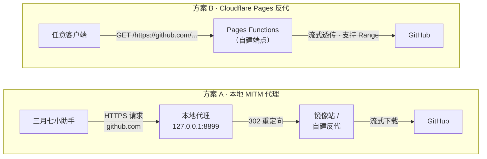

# March7th 更新加速 · GitHub 下载加速方案

> 让国内网络（虚拟机 / 受限网络 / 无代理环境）以 **6～7 MB/s** 从 GitHub 下载 release，
> 而不是 15 KB/s 等到超时。

针对 [March7thAssistant](https://github.com/moesnow/March7thAssistant)（三月七小助手）
每周下载约 454 MB 完整更新包的场景做的，但原理对任何 GitHub release 下载都通用。

---

## 问题

某个环境里（比如跑在 NAS 上的 Windows 虚拟机），直连 GitHub 的下行速度只有：

| 路径 | 速度 | 结果 |
|---|---|---|
| 直连 `github.com` | **0.016 MB/s** | 454 MB 必然超时 |
| 走公共镜像 | 5.4 MB/s | 可用 |
| 走自建反代 | **6.3～7.1 MB/s** | 可用 |

而软件本身支持填「下载代理」，这就给了本地拦截的空间。

## 两套方案

两套互不依赖，可以只用其中一个，也可以叠起来用。



| | 方案 A：本地 MITM 代理 | 方案 B：Cloudflare Pages 反代 |
|---|---|---|
| 运行位置 | 目标机器本地 | Cloudflare 边缘网络 |
| 依赖 | .NET Framework（Windows 自带） | 一个 Cloudflare 账号（免费额度足够） |
| 生效范围 | 只对能填「下载代理」的程序 | 任何能发 HTTP 请求的客户端 |
| 能否脱离代理软件 | 不能，仍需一个镜像站做落点 | 能，自己就是端点 |
| 代码 | [`local-proxy/`](local-proxy/) | [`pages-proxy/`](pages-proxy/) |

推荐组合：**方案 B 提供端点，方案 A 把请求引过去**。这样既不消耗付费代理流量，
也不依赖会跑路的公共镜像站。

## 快速开始

### 方案 A：本地代理

```powershell
# 1. 把 local-proxy/ 整个目录拷到目标机器
# 2. 先看一眼不改动任何东西的自检
powershell -NoProfile -ExecutionPolicy Bypass -File deploy.ps1 -CheckOnly

# 3. 正式部署（双击 install.bat，或管理员 PowerShell 里跑）
powershell -NoProfile -ExecutionPolicy Bypass -File deploy.ps1

# 4. 软件里填代理：设置 → 关于 → 更新源 → 下载代理 → 127.0.0.1:8899

# 5. 双击桌面「M7A 更新加速状态」启动托盘，右下角出现绿点即为正常
```

完整参数、证书机制、回滚方式见 **[local-proxy/README.md](local-proxy/README.md)**。

### 方案 B：Cloudflare Pages 反代

```powershell
# 1. 装 wrangler 或直接用仓库里的 API 脚本
$env:CF_TOKEN   = '<你的 API token，需要 Pages:Edit>'
$env:CF_ACCOUNT = '<你的 Account ID>'
$env:CF_PROJECT = 'm7a-gh'

# 2. 部署（自动创建项目并上传 _worker.js）
node deploy_api.mjs

# 3. 验证
curl.exe -s -o NUL -w "%{http_code}\n" `
  "https://m7a-gh.pages.dev/https://raw.githubusercontent.com/moesnow/March7thAssistant/master/README.md"
```

细节、路径暗号、排障表见 **[pages-proxy/README.md](pages-proxy/README.md)**。

## 实测数据

20 MB 分片，取 `March7thAssistant_full.7z` 前 20 MB，同一台机器同一时段：

| 路径 | 速度 | 耗时 |
|---|---|---|
| 经自建 Pages 反代（三次） | 7.12 / 6.37 / 5.51 MB/s | 2.95 / 3.29 / 3.80 s |
| 经 `gh-proxy.com` | 5.42 MB/s | 3.87 s |
| Cloudflare 边缘吞吐基线 | 5.51 MB/s | 3.63 s |
| 直连 GitHub | 0.016 MB/s | 超时 |

454 MB 完整包按 6.5 MB/s 估算约 **70 秒**。

## 实现要点

几个踩过才知道的坑，都写进代码注释了：

- **必须流式透传**，不能把响应缓冲下来，否则 454 MB 会撑爆内存
- **必须透传 `Range` 头**，否则更新器的断点续传失效
- **`_worker.js` 要作为 `_worker.bundle` 嵌套 multipart 上传**，纯静态上传平台不会当 worker 跑
- **.NET 4.0 的 `HttpWebRequest` 默认只说 TLS 1.0**，会被 Cloudflare 拒握手
- **SYSTEM 身份跑的服务显示不了托盘图标**（session 0），监控器必须跑在用户会话

## 已知限制

方案 A 的拦截范围是「填了下载代理的那个程序里的 `github.com` 请求」，
它**不是通用 GitHub 加速器**——浏览器开网页、`git clone` 都管不了。

方案 B 只允许 GitHub 系域名，避免变成任意站点的开放代理。

## 关于

本项目由 **DeepSeek** 与 **MiMo** 协作完成。

## 许可

MIT
